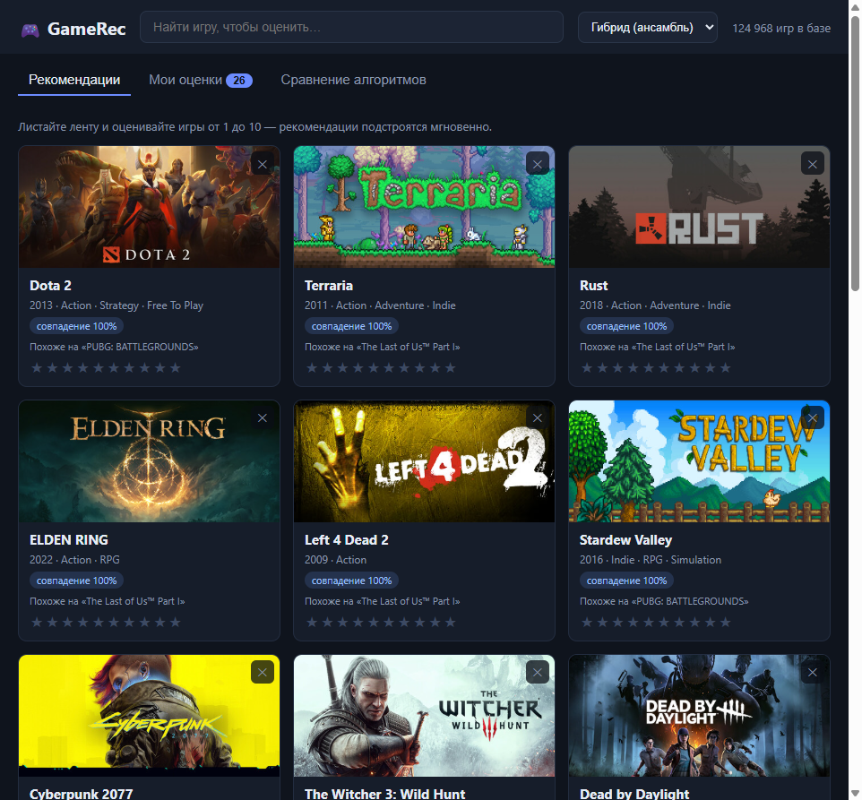
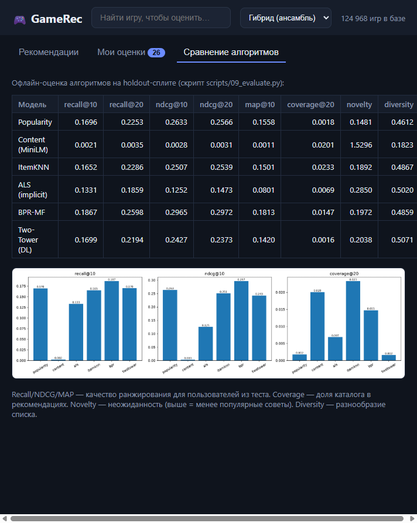

# GameRec — Game Recommendation System

[](https://github.com/rawspec/game-recsys/actions/workflows/ci.yml)
[](LICENSE)
[](https://www.python.org)

An open-source, end-to-end **recommendation system for video games**: 125K-game catalog,
seven recommendation algorithms with an ensemble hybrid, offline evaluation with
standard ranking metrics, and a web UI with an infinite recommendation feed.



> 🌐 [Русская версия](README.ru.md)

## Why this project exists

Recommendation engines of gaming platforms (Steam, RAWG, EGS) are closed black boxes —
you cannot compare algorithms or reproduce their results. Educational repos usually
stop at MovieLens + a single matrix factorization. This project fills the gap: a
**practical, production-shaped recommender** over a real 125K-game catalog where you
can switch algorithms live, inspect *why* an item is recommended, and compare models
with offline metrics (Recall/NDCG/MAP, coverage, novelty, diversity).

## Features

- **125,968 games** — merged from two public Steam datasets (descriptions, genres,
  tags, cover art via Steam CDN)
- **13M user–game interactions** (78K real Steam users, playtime → confidence)
- **7 algorithms + ensemble**, switchable live in the UI:
  | Algorithm | Family | Notes |
  |---|---|---|
  | Popularity | baseline | cold start |
  | Content (MiniLM) | content-based | `paraphrase-multilingual-MiniLM-L12-v2` embeddings over name/genres/tags/description |
  | ItemKNN | collaborative | cosine item–item, TF-normalized, top-200 |
  | ALS (implicit) | collaborative | Hu et al. 2008, NumPy implementation, `confidence = 1 + log1p(hours)` |
  | BPR-MF | collaborative | pairwise ranking, Adagrad, user vector = history mean |
  | Two-Tower | neural (PyTorch) | InfoNCE with in-batch negatives + popularity log-Q correction, user tower = MLP(history mean) |
  | LightFM (WARP) | hybrid | optional (Linux/macOS wheels) |
  | **Hybrid** | ensemble | content + ALS blend, ALS weight warms up with #ratings + popularity prior |
- **Explicit ratings 1–10** with instant fold-in (new user as a new row in ALS / mean
  pooling for MF models / weighted centroid for content)
- **Offline evaluation** on a per-user 80/20 holdout: Recall@10/20, NDCG@10/20, MAP@10,
  Coverage@20, Novelty, Diversity — results table + charts in the UI and README
- Web UI (vanilla JS, infinite scroll, search, "because you liked …" explanations,
  hide/unrate, per-algorithm feed, metrics dashboard)
- Docker + docker-compose, GitHub Actions CI, pytest suite on synthetic data

## Quickstart

### Docker (everything auto-downloads and trains on first run, ~15–25 min)

```bash
docker compose up --build
# open http://localhost:8000
```

### Local

```bash
python -m venv .venv
source .venv/bin/activate          # Windows: .venv\Scripts\activate

# PyTorch: CPU wheel works out of the box
pip install torch --index-url https://download.pytorch.org/whl/cpu
# for NVIDIA GPUs (e.g. RTX 50xx, sm_120) use CUDA build instead:
# pip install --force-reinstall --no-deps torch --index-url https://download.pytorch.org/whl/cu130

pip install -r requirements.txt
# optional: LightFM (needs a C toolchain on Windows; wheels exist for Linux/macOS)
# pip install lightfm

# one-time pipeline: download ~500 MB → catalog → embeddings → train 5 models → evaluate
python pipeline.py

# serve
python -m app.server --open        # http://127.0.0.1:8000
```

Rate games from 1 to 10 (search box or star widgets on cards). The feed re-ranks
instantly. Pick an algorithm in the header dropdown; open **"Compare algorithms"**
for the offline metrics dashboard.

## Offline evaluation

Protocol: per-user random 80/20 split (users with ≥5 interactions, seed 42,
≤8000 test users). Relevance = game present in the user's test interactions.
Train items are excluded from ranking; items without any training signal are
pushed to the back. Full code: [`scripts/09_evaluate.py`](scripts/09_evaluate.py).

| Model | Recall@10 | Recall@20 | NDCG@10 | NDCG@20 | MAP@10 | Coverage@20 | Novelty | Diversity |
|---|---|---|---|---|---|---|---|---|
| popularity | 0.1696 | 0.2253 | 0.2633 | 0.2566 | 0.1558 | 0.0018 | 0.1481 | 0.4612 |
| content | 0.0021 | 0.0035 | 0.0028 | 0.0031 | 0.0011 | 0.0201 | 1.5296 | 0.1823 |
| itemknn | 0.1652 | 0.2286 | 0.2507 | 0.2539 | 0.1501 | 0.0233 | 0.1892 | 0.4867 |
| als | 0.1331 | 0.1859 | 0.1252 | 0.1473 | 0.0801 | 0.0069 | 0.2850 | 0.5020 |
| bpr | 0.1867 | 0.2598 | 0.2965 | 0.2972 | 0.1813 | 0.0147 | 0.1972 | 0.4859 |
| twotower | 0.1764 | 0.2305 | 0.2507 | 0.2462 | 0.1464 | 0.0017 | 0.1796 | 0.5011 |

**How to read these numbers.** BPR-MF is the best personalized model on hit-rate
metrics and even beats the popularity baseline — pairwise ranking with a
representation consistent between training and inference pays off. ItemKNN and the
Two-Tower land on par with popularity. Raw content similarity is essentially random
at hit-rate but maximizes novelty — it surfaces long-tail lookalikes (nearest
neighbors of *Dota 2* are obscure MOBA clones), which hit-rate punishes. That
tension between accuracy and beyond-accuracy goals is exactly what makes
recommender evaluation interesting; the UI lets you *feel* it by switching
algorithms on your own ratings.

**The ALS regularization story** (a good interview topic): textbook ALS for implicit
feedback uses `reg ≈ 0.01–0.1`, which here gives Recall@10 = **0.001** — the model
memorizes. Steam users own ~170 games on average, so per-user second-moment sums
are two orders of magnitude larger than in textbook movieLens-scale setups, and the
same λ is negligible in comparison. Scaling `reg` to **32** (found by offline
sweep, +80× recall) and regularizing fold-in separately (`reg_fold-in = 100`)
makes ALS work — a concrete example of why regularization must be scaled to the
data, not copied from a tutorial.



Reproduce with:

```bash
python scripts/09_evaluate.py
```

## How it works

```
raw datasets            pipeline                          serving
┌─────────────────┐   ┌──────────────────────────────┐   ┌────────────────────────┐
│ Steam catalog    │ → │ 01 download                  │   │ FastAPI                │
│ (125K games)     │   │ 02 merge + interactions      │   │  /api/recommendations  │
│ +                │ → │ 03 MiniLM embeddings (GPU)   │ → │  /api/search           │
│ 78K users,       │   │ 04 ALS  05 ItemKNN  06 BPR   │   │  /api/rate  /api/metrics│
│ 13M ownerships   │   │ 07 Two-Tower  08 LightFM(opt)│   │  + static UI           │
└─────────────────┘   │ 09 offline evaluation        │   └────────────────────────┘
                      └──────────────────────────────┘
```

Scoring a new user with ratings `r_i ∈ [1,10]` and weights `w_i = (r_i − 5.5)/4.5`:

- **Content**: `u = Σ w_i e_i / ‖·‖`, score = cos(u, e_j)
- **ALS fold-in**: `x = (Yᵀ C Y + λI)⁻¹ Yᵀ c`, score = `Y x` — a new row of the
  implicit-feedback system (Hu et al., 2008)
- **MF models (BPR, LightFM, Two-Tower)**: user vector = weighted mean of item
  factors (the same pooling used at training time for Two-Tower), score = dot
- **Hybrid**: `(1−α)·content + α·ALS`, `α = 0.5·min(1, n_rated/15)`, plus a 0.08
  popularity prior; with no ratings it degrades gracefully to popularity

Ratings are stored in SQLite (`data/app.db`); re-ranking a 125K catalog takes
~50 ms, so personalization is effectively instant.

## Project structure

```
app/
  models/            # one module per algorithm + registry
  server.py          # FastAPI API
  recommender.py     # per-algorithm ranking cache
  store.py           # catalog + SQLite
scripts/
  01_download.py     # raw datasets (Hugging Face, no auth)
  02_build_catalog.py# merge catalogs + interaction matrix
  03_embed.py        # sentence-transformer embeddings (GPU)
  04-08 train_*.py   # ALS, ItemKNN, BPR, Two-Tower, LightFM(opt)
  09_evaluate.py     # holdout metrics + charts
  trainers.py        # shared training core
web/                 # vanilla JS UI (no build step)
tests/               # pytest on synthetic data
```

## Data & licenses

- [`FronkonGames/steam-games-dataset`](https://huggingface.co/datasets/FronkonGames/steam-games-dataset) — game metadata
- [`steamgamerecommender/data_files_public`](https://huggingface.co/datasets/steamgamerecommender/data_files_public) — ownerships & friendships (GPL-3.0)
- Cover art is served from Steam CDN and belongs to its owners.

Code is MIT-licensed. Not affiliated with Valve or Steam.

## Troubleshooting

- **Segfault while loading sentence-transformers on Python 3.15** — set
  `HF_DEACTIVATE_ASYNC_LOAD=1` (already set inside `scripts/03_embed.py`); this is a
  transformers 5.22 threaded-weight-loading issue.
- **LightFM skipped** — it needs a C compiler on Windows; everything else works
  without it. On Linux Docker image it installs automatically.
- **Full reset**: delete `data/` and rerun `python pipeline.py`. Ratings-only reset:
  delete `data/app.db`.

## Roadmap

- SteamSpy live enrichment, temporal split evaluation, online A/B comparison,
  export/import of ratings, quantization/serving with ONNX
