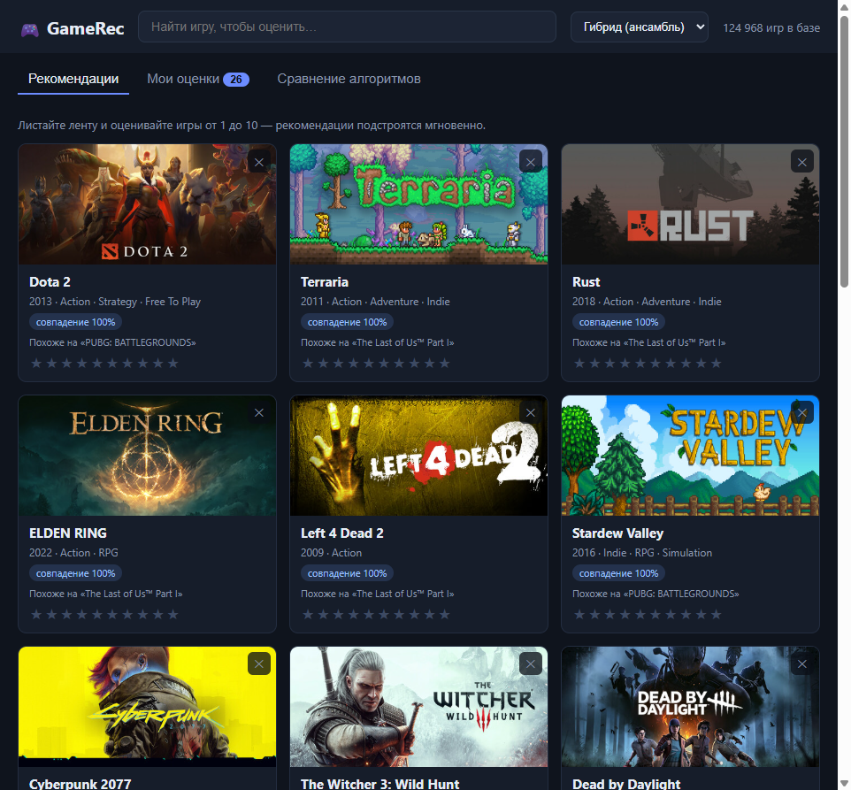
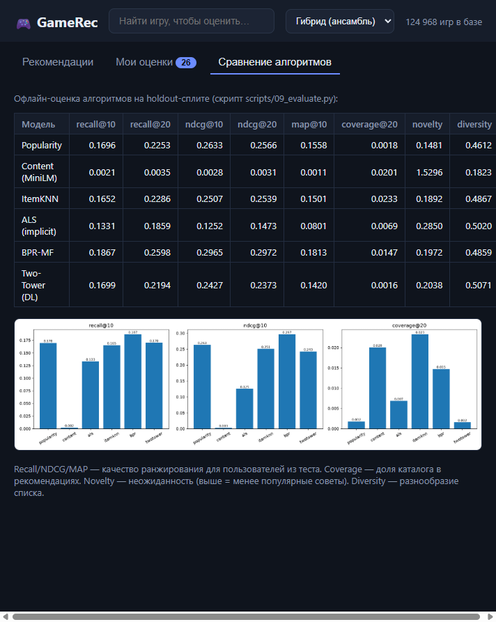

# GameRec — рекомендательная система игр

[](https://github.com/rawspec/game-recsys/actions/workflows/ci.yml)
[](LICENSE)
[](https://www.python.org)

Открытая рекомендательная система видеоигр «под ключ»: каталог из 125 тысяч игр,
семь алгоритмов рекомендаций + ансамблевый гибрид, офлайн-оценка стандартными
метриками ранжирования и веб-интерфейс с бесконечной лентой.



> 🌐 [English version](README.md)

## Зачем этот проект

Рекомендации игровых платформ (Steam, RAWG, EGS) — закрытые «чёрные ящики»: нельзя
сравнить алгоритмы и воспроизвести результат. Учебные репозитории обычно ограничиваются
MovieLens и одной матричной факторизацией. Здесь — **практичный продакшн-подобный
рекомендатель** на реальном каталоге из 125K игр: переключение алгоритмов «на лету»,
объяснения «почему рекомендовано» и сравнение моделей офлайн-метриками
(Recall/NDCG/MAP, покрытие, новизна, разнообразие).

## Возможности

- **125 968 игр** — слияние двух открытых датасетов Steam (описания, жанры, теги,
  обложки с CDN Steam)
- **13 млн взаимодействий «пользователь ↔ игра»** (78 тыс. реальных пользователей
  Steam, игровое время → confidence)
- **7 алгоритмов + ансамбль**, переключаются в интерфейсе:
  | Алгоритм | Семейство | Примечания |
  |---|---|---|
  | Popularity | бейзлайн | холодный старт |
  | Content (MiniLM) | контентный | эмбеддинги `paraphrase-multilingual-MiniLM-L12-v2` по названию/жанрам/тегам/описанию |
  | ItemKNN | коллаборативный | косинусная item-item, TF-нормализация, top-200 |
  | ALS (implicit) | коллаборативный | Hu et al. 2008, реализация на NumPy, `confidence = 1 + log1p(часы)` |
  | BPR-MF | коллаборативный | попарное ранжирование, Adagrad, профиль = среднее истории |
  | Two-Tower | нейросеть (PyTorch) | InfoNCE с in-batch негативами и log-Q поправкой, user-tower = MLP(среднее истории) |
  | LightFM (WARP) | гибридный | опционально (колёса есть для Linux/macOS) |
  | **Hybrid** | ансамбль | бленд контента и ALS, вес ALS растёт с числом оценок + популярностный prior |
- **Оценки 1–10** с мгновенным fold-in (новый пользователь = новая строка в ALS /
  среднее факторов для MF / взвешенный центроид для контента)
- **Офлайн-оценка** на пер-пользовательском holdout 80/20: Recall@10/20, NDCG@10/20,
  MAP@10, Coverage@20, Novelty, Diversity — таблица и графики в UI и README
- Веб-интерфейс (vanilla JS, бесконечная лента, поиск, объяснения «похоже на…»,
  скрытие/удаление оценок, лента на каждый алгоритм, дашборд метрик)
- Docker + docker-compose, GitHub Actions CI, pytest на синтетических данных

## Быстрый старт

### Docker (при первом запуске само скачает данные и обучит модели, ~15–25 мин)

```bash
docker compose up --build
# открыть http://localhost:8000
```

### Локально

```bash
python -m venv .venv
source .venv/bin/activate          # Windows: .venv\Scripts\activate

# PyTorch: CPU-версия ставится сразу
pip install torch --index-url https://download.pytorch.org/whl/cpu
# для NVIDIA (например RTX 50xx, sm_120) — CUDA-сборка:
# pip install --force-reinstall --no-deps torch --index-url https://download.pytorch.org/whl/cu130

pip install -r requirements.txt
# опционально LightFM (на Windows нужен C-компилятор; на Linux/macOS — колёса)
# pip install lightfm

# одноразовый пайплайн: скачивание ~500 МБ → каталог → эмбеддинги → 5 моделей → оценка
python pipeline.py

# запуск сервера
python -m app.server --open        # http://127.0.0.1:8000
```

Оценивайте игры от 1 до 10 (поиск сверху или звёздочки на карточках) — лента
переренжируется мгновенно. Алгоритм выбирается в выпадающем списке в шапке,
вкладка **«Сравнение алгоритмов»** — дашборд офлайн-метрик.

## Офлайн-оценка

Протокол: случайный пер-пользовательский сплит 80/20 (пользователи с ≥5
взаимодействиями, seed 42, ≤8000 тестовых пользователей). Релевантность = игра есть
в тесте. Train-айтемы исключаются из ранжирования; айтемы без обучающего сигнала
отодвигаются назад. Код: [`scripts/09_evaluate.py`](scripts/09_evaluate.py).

| Модель | Recall@10 | Recall@20 | NDCG@10 | NDCG@20 | MAP@10 | Coverage@20 | Novelty | Diversity |
|---|---|---|---|---|---|---|---|---|
| popularity | 0.1696 | 0.2253 | 0.2633 | 0.2566 | 0.1558 | 0.0018 | 0.1481 | 0.4612 |
| content | 0.0021 | 0.0035 | 0.0028 | 0.0031 | 0.0011 | 0.0201 | 1.5296 | 0.1823 |
| itemknn | 0.1652 | 0.2286 | 0.2507 | 0.2539 | 0.1501 | 0.0233 | 0.1892 | 0.4867 |
| als | 0.1331 | 0.1859 | 0.1252 | 0.1473 | 0.0801 | 0.0069 | 0.2850 | 0.5020 |
| bpr | 0.1867 | 0.2598 | 0.2965 | 0.2972 | 0.1813 | 0.0147 | 0.1972 | 0.4859 |
| twotower | 0.1764 | 0.2305 | 0.2507 | 0.2462 | 0.1464 | 0.0017 | 0.1796 | 0.5011 |

**Как читать эти числа.** BPR-MF — лучшая персонализированная модель по метрикам
попаданий и опережает даже бейзлайн популярности: попарное ранжирование с
представлением пользователя, согласованным между обучением и инференсом, окупается.
ItemKNN и Two-Tower — на уровне популярности. Чистая контентная близость практически
случайна по hit-rate, но максимизирует новизну — она вытаскивает нишевых
«клонов» (ближайшие соседи Dota 2 — малоизвестные китайские MOBA), за что hit-rate
её и наказывает. Это противопоставление accuracy vs beyond-accuracy — то, что делает
оценку рекомендеров интересной; в интерфейсе можно почувствовать разницу,
переключая алгоритмы на собственных оценках.

**История регуляризации ALS** (хорошая тема для собеседования): «учебный» ALS для
implicit feedback использует `reg ≈ 0.01–0.1`, что здесь даёт Recall@10 = **0.001** —
модель заучивает данные. Пользователи Steam в среднем владеют ~170 играми, поэтому
суммы вторых моментов на пользователя на два порядка больше, чем в учебных задачах
масштаба MovieLens, и тот же λ просто исчезает на их фоне. Масштабирование `reg`
до **32** (найдено офлайн-перебором, +80× к recall) и отдельная регуляризация
fold-in (`reg_fold-in = 100`) заставляют ALS работать — конкретный пример того, что
регуляризацию нужно масштабировать под данные, а не копировать из туториала.



Воспроизвести:

```bash
python scripts/09_evaluate.py
```

## Как это работает

```
сырые датасеты         пайплайн                          сервинг
┌─────────────────┐   ┌──────────────────────────────┐   ┌────────────────────────┐
│ Каталог Steam    │ → │ 01 скачивание                │   │ FastAPI                │
│ (125K игр)       │   │ 02 слияние + взаимодействия  │   │  /api/recommendations  │
│ +                │ → │ 03 эмбеддинги MiniLM (GPU)   │ → │  /api/search           │
│ 78K пользователей│   │ 04 ALS  05 ItemKNN  06 BPR   │   │  /api/rate /api/metrics│
│ 13M владений     │   │ 07 Two-Tower 08 LightFM(opt) │   │  + статика UI          │
└─────────────────┘   │ 09 офлайн-оценка             │   └────────────────────────┘
                      └──────────────────────────────┘
```

Скоринг нового пользователя с оценками `r_i ∈ [1,10]` и весами `w_i = (r_i − 5.5)/4.5`:

- **Content**: `u = Σ w_i e_i / ‖·‖`, скор = cos(u, e_j)
- **ALS fold-in**: `x = (Yᵀ C Y + λI)⁻¹ Yᵀ c`, скор = `Y x` — новая строка системы
  implicit-feedback (Hu et al., 2008)
- **MF-модели (BPR, LightFM, Two-Tower)**: вектор пользователя = взвешенное среднее
  факторов айтемов (для Two-Tower — то же пулинг, что и при обучении), скор = скалярное произведение
- **Hybrid**: `(1−α)·content + α·ALS`, `α = 0.5·min(1, n_rated/15)`, плюс prior
  популярности 0.08; без оценок вырождается в популярное

Оценки хранятся в SQLite (`data/app.db`); переренжирование каталога 125K занимает
~50 мс — персонализация практически мгновенная.

## Структура проекта

```
app/
  models/            # по модулю на алгоритм + реестр
  server.py          # FastAPI API
  recommender.py     # кэш ранжирования на алгоритм
  store.py           # каталог + SQLite
scripts/
  01_download.py     # сырые датасеты (Hugging Face, без авторизации)
  02_build_catalog.py# слияние каталогов + матрица взаимодействий
  03_embed.py        # эмбеддинги sentence-transformer (GPU)
  04-08 train_*.py   # ALS, ItemKNN, BPR, Two-Tower, LightFM(opt)
  09_evaluate.py     # holdout-метрики + графики
  trainers.py        # общее ядро обучения
web/                 # UI на vanilla JS (без сборки)
tests/               # pytest на синтетике
```

## Данные и лицензии

- [`FronkonGames/steam-games-dataset`](https://huggingface.co/datasets/FronkonGames/steam-games-dataset) — метаданные игр
- [`steamgamerecommender/data_files_public`](https://huggingface.co/datasets/steamgamerecommender/data_files_public) — владения и дружбы (GPL-3.0)
- Обложки отдаются с CDN Steam и принадлежат их правообладателям.

Код под лицензией MIT. Проект не аффилирован с Valve или Steam.

## Если что-то пошло не так

- **Сегфолт при загрузке sentence-transformers на Python 3.15** — выставлен
  `HF_DEACTIVATE_ASYNC_LOAD=1` (уже внутри `scripts/03_embed.py`); это баг threaded
  загрузки весов в transformers 5.22.
- **LightFM пропущен** — на Windows нужен C-компилятор; без него всё работает.
  В Docker-образе (Linux) ставится автоматически.
- **Полный сброс**: удалить `data/` и повторить `python pipeline.py`. Сброс только
  оценок: удалить `data/app.db`.

## Планы

- Обогащение данными SteamSpy, временной сплит в оценке, онлайн-сравнение (A/B),
  экспорт/импорт оценок, сервинг через ONNX
